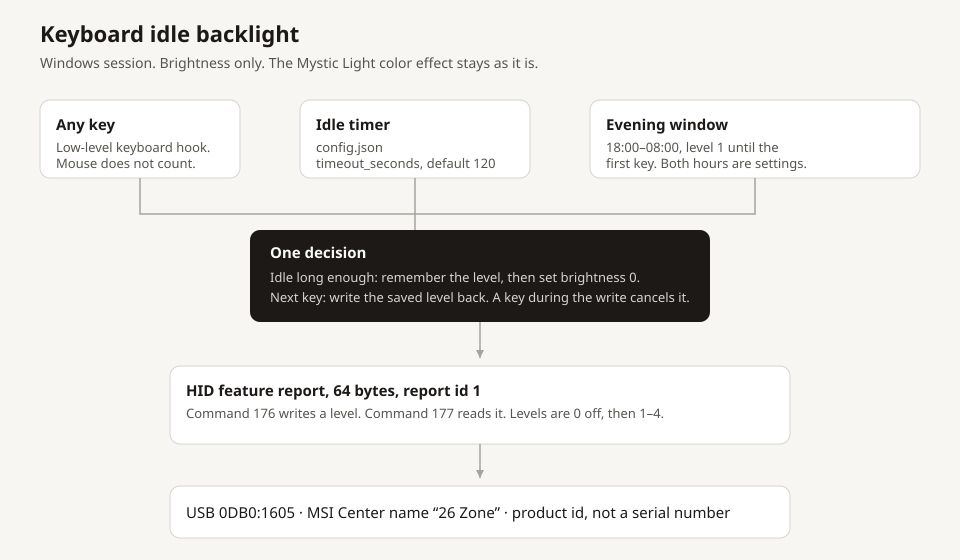

# MSI keyboard backlight idle

MSI Center and Mystic Light can set the color and the brightness of a gaming-laptop keyboard, and on many models they leave the **keyboard backlight** on until you turn it off yourself. There is no **keyboard backlight timeout**.

This is a small Windows program that turns that backlight off after the keyboard sits idle, then puts the same brightness back when you press a key. Mouse movement does not wake it.

It talks to the keyboard MSI Center calls **26 Zone** (USB product id `0DB0:1605`, the same id on every matching laptop, including the Vector A18 HX). SteelSeries per-key boards and older MSI keyboards use a different controller, so this program will not see them.

The USB id is a product id, shared by that keyboard model. It is not a serial number.

## How it is wired



A keypress only resets a timer. When the keyboard has been quiet for `timeout_seconds`, the program reads the current brightness, stores it, and writes level 0. The next key writes that stored level back. Color, zones, and the Mystic Light effect are never written.

From `evening_from_hour` until `evening_until_hour`, a fresh start uses `evening_level` and puts it back if startup software turns the backlight off. That restore stops at the first key. After that, the idle timer is in charge.

## What you need

- Windows 10 or 11
- [Python 3.10 or newer](https://www.python.org/downloads/). During setup, enable **Add python.exe to PATH**.
- No extra packages. MSI Center can stay installed. The program only changes brightness (LEDKeeper levels 0–4) and leaves the current Mystic Light effect alone.

## Run it

1. Download this repository (**Code → Download ZIP**) and unzip it, or `git clone` it.
2. Open PowerShell in that folder.
3. Check Python:

```powershell
python --version
```

4. Start it in a window so you can see that it found the keyboard:

```powershell
python kbd_idle.py
```

5. Stop typing for the number of seconds in `config.json` (120 by default). The light goes off. Press any key and the previous brightness comes back.

A log file, `kbd_idle.log`, appears next to the script and stays on your computer. A line like `off, will restore 2` means it is working. `evening on failed` or a missing keyboard means this program does not see a 26 Zone device.

Close the window to stop it. To run with no window:

```powershell
pythonw kbd_idle.py
```

Only one copy runs at a time. Starting it again does nothing until you close the first one.

## Start it with Windows

In the same folder:

```powershell
powershell -ExecutionPolicy Bypass -File .\install_startup.ps1
```

That creates a Startup shortcut named **MSI Keyboard Idle**. It runs at the next sign-in, with no console window. To stop that, delete the shortcut from the Startup folder:

```powershell
explorer shell:startup
```

## Settings

Edit `config.json`, then start the program again.

| Setting | Meaning | Default |
| --- | --- | --- |
| `timeout_seconds` | Seconds after the last key before the light turns off. Minimum 1. | `120` |
| `evening_from_hour` | Hour the dim window starts, 0–23. | `18` |
| `evening_until_hour` | Hour the dim window ends, 0–23. | `8` |
| `evening_level` | Brightness used in that window until the first key, 1–4. | `1` |

Brightness is `0` (off) through `4`. Level `1` is the dimmest step that is still on.

From `evening_from_hour` until `evening_until_hour`, a fresh start sets the keyboard to `evening_level`. Mystic Light often switches the backlight off once while Windows is starting; until the first key, the program puts that level back, so the light is already on when you sit down. After that first key, the idle timer works as usual and later restores whatever brightness you were using.

Set `evening_from_hour` and `evening_until_hour` to the same hour to skip the dim window.

```json
{
  "timeout_seconds": 120,
  "evening_from_hour": 18,
  "evening_until_hour": 8,
  "evening_level": 1
}
```

## What it does not do

- It does not change color, zones, or the Mystic Light effect. Brightness only.
- It does not run on SteelSeries per-key keyboards (many GE, GS, GT, and Stealth models) or on the older 3-zone boards.
- It does not turn the light off while the laptop is asleep. It runs in your Windows session.
- Keys on an external keyboard also count as activity, because Windows reports them the same way.

## Kaip paleisti (Windows)

1. Įdiek Python 3.10 ar naujesnį iš [python.org](https://www.python.org/downloads/) ir pažymėk **Add python.exe to PATH**.
2. Atsisiųsk šį repo (**Code → Download ZIP**) ir išskleisk.
3. Tame aplanke atidaryk PowerShell ir paleisk `python kbd_idle.py`.
4. Palauk `config.json` nurodytą laiką (`timeout_seconds`, numatytai 120 sekundžių). Šviesa užgęsta. Paspaudus bet kurį klavišą grįžta ankstesnis ryškumas.
5. Kad programa startuotų kartu su Windows, tame pačiame aplanke paleisk `powershell -ExecutionPolicy Bypass -File .\install_startup.ps1`. Nuoroda atsiranda Startup aplanke. Ją ištrynus, automatinis startas nutrūksta.
6. Laukimo laiką ir vakaro ryškumą keisk faile `config.json`.

Žurnalas `kbd_idle.log` lieka tik tame kompiuteryje.

## Words people search for

These are the phrases people actually type when MSI Center has no idle timer:

- MSI keyboard backlight timeout
- keyboard backlight turns off by itself
- keyboard lights stay on
- Mystic Light no auto off
- turn off keyboard backlight when idle
- MSI Center always on or auto turn off in 10 sec
- 26 zone RGB keyboard brightness
- LEDKeeper brightness level
- keyboard light on at startup then turns off
